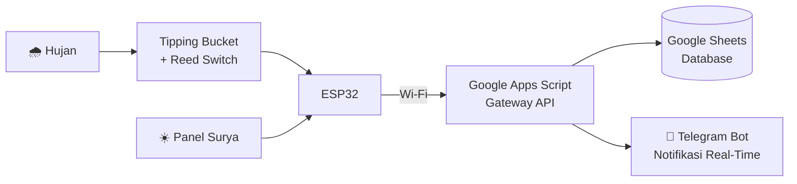

<!-- ============ HEADER ============ -->
<div align="center">


<a href="https://git.io/typing-svg">
  
</a>

<br/>

[](https://GANTI-DENGAN-LINK-PORTOFOLIO)
[](https://linkedin.com/in/muhammad-ahya-ba21b2430)
[](mailto:m.ahya.amt123@gmail.com)
[](https://instagram.com/mhmmdahya__)

</div>

---

## 👋 Halo, saya Ahya!

Lulusan **S-1 Fisika (Instrumentasi)** Universitas Lambung Mangkurat yang suka menjembatani **teori dan praktik**: dari merancang sensor dan sistem IoT, menangani instalasi kelistrikan di lapangan, sampai mengolah visual lewat foto dan video.

Bagi saya, teknologi bukan hanya soal *bagaimana sistem bekerja*, tetapi juga *bagaimana ia bisa terus disempurnakan*.

```python
class MuhammadAhya:
    def __init__(self):
        self.role      = ["Instrumentation Engineer", "Electrical Technician", "Photo & Video Editor"]
        self.education = "B.Sc. Physics (Instrumentation), ULM, GPA 3.41/4.00"
        self.based_in  = "Banjarbaru, Kalimantan Selatan 🇮🇩"
        self.focus     = ["IoT Monitoring", "Sensor Integration & Calibration", "Embedded Systems"]
        self.languages = {"Indonesia": "Fluent", "English": "Intermediate"}
        self.status    = "Open to work & freelance projects 🚀"

    def motto(self):
        return "Dari Gagasan Menjadi Inovasi"
```

---

## 🔭 Sedang Saya Kerjakan & Pelajari

- 🌧️ Mengembangkan sistem **monitoring curah hujan berbasis IoT** dan energi hijau
- 📡 Memperdalam **sensor integration**, **embedded systems**, dan **data validation**
- 🌐 Membangun dan memoles **website portofolio** pribadi
- 🎨 Mengasah penyuntingan visual (foto & video) sebagai proyek freelance

---

## 🛠️ Tech Stack & Tools

**Programming, Embedded & IoT**

<p>
  
  
  
  
</p>

**Engineering, Data & Reporting**

<p>
  
  
  
</p>

**Design & Multimedia**

<p>
  
  
  
</p>

**Electrical & Instrumentation**

`Electrical Wiring` · `Instalasi Listrik` · `Sensor Calibration` · `Voltage Measurement` · `Preventive Maintenance` · `Hardware Troubleshooting` · `Equipment Debugging` · `Data Validation` · `K3`

---

## ⚡ Proyek Unggulan: Monitoring Curah Hujan Berbasis IoT

Prototipe alat pemantau curah hujan otomatis dengan konsep **green energy**, dirancang, dirakit, dikalibrasi, dan divalidasi sendiri, dengan **error hasil perbandingan hanya 1,01%**.



| Aspek | Detail |
|---|---|
| **Mikrokontroler** | ESP32 |
| **Sensor** | Tipping bucket + reed switch |
| **Daya** | Panel surya (green energy) |
| **Database** | Google Sheets via Google Apps Script |
| **Monitoring** | Telegram Bot, real-time |
| **Akurasi** | Error 1,01% hasil perbandingan |

---

## 💼 Perjalanan Profesional

| Periode | Peran | Tempat |
|---|---|---|
| Agu 2026 – Okt 2026 | **Electrical Technician** (Pelayanan & Penyambungan) | PT Berkat Usaha Jaya |
| Okt 2025 – Jan 2026 | **Engineering Intern**: Environmental & Mine Water Management | PT Adaro Indonesia |
| Nov 2025 – Sekarang | **Freelance Photo & Video Editor** | Banjarbaru |
| Jan 2025 – Agu 2025 | **Wedding Organizer Team** | sitiliawedding |

**Sorotan:** 🔌 7–9 SPK per hari sebagai teknisi · 💧 Monitoring 4–6 settling pond per hari · 🎞️ 10+ proyek foto & video

---

## 🏆 Pencapaian & Kepemimpinan

- 🥈 **2nd Best Graduate**, Prodi Fisika, Wisuda ke-132 Universitas Lambung Mangkurat
- 🎤 **Best Presenter**, SENFIT VII (bidang Instrumentasi & Fisika Komputasi)
- 👥 **Ketua Himpunan Mahasiswa Fisika**: memimpin 35+ anggota dan 9 pengurus inti
- 🌴 **Abdi Daya Ormawa**: tim lolos pendanaan nasional dari **2.289 subproposal**, satu-satunya tim ULM yang tampil di Abdidaya PPK Ormawa 2024 Bali
- 🏛️ **DPM FMIPA (Komisi 2: Anggaran & Pengawasan)**: mengawasi anggaran 12 Ormawa

---

## 📊 GitHub Stats

<div align="center">


</div>

---

## 🤝 Mari Berkolaborasi

Terbuka untuk **peluang kerja** di bidang instrumentasi, kelistrikan, dan IoT, serta **proyek freelance** penyuntingan foto dan video.

📧 **m.ahya.amt123@gmail.com** · 💼 [LinkedIn](https://linkedin.com/in/muhammad-ahya-ba21b2430) · 📸 [Instagram](https://instagram.com/mhmmdahya__)

<div align="center">


</div>
